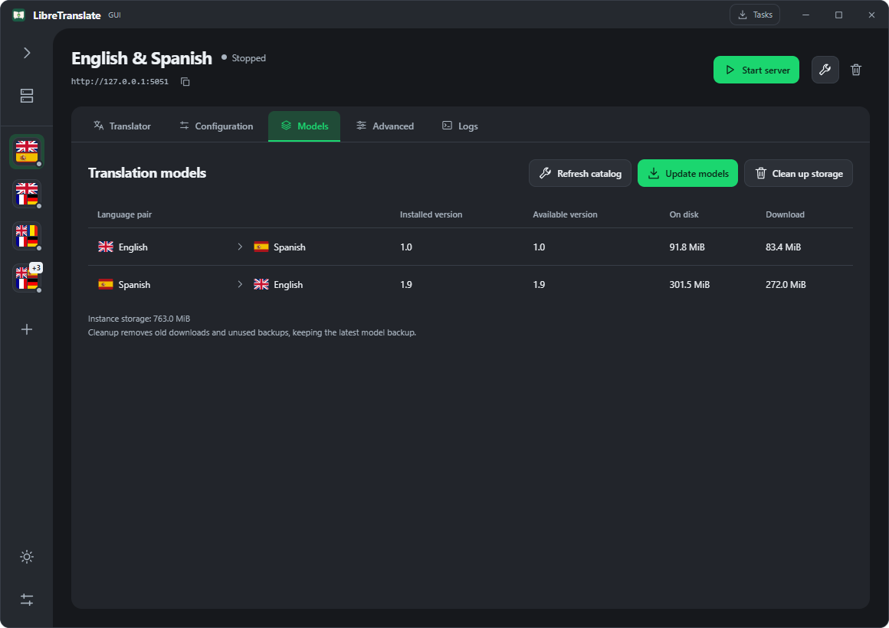

<p align="center">
  
</p>

<h1 align="center">LibreTranslate GUI</h1>

<p align="center">Run and manage LibreTranslate on your own computer.</p>

<p align="center">
  <a href="https://github.com/shadersmods/libretranslate-gui/releases"></a>
  <a href="https://github.com/shadersmods/libretranslate-gui/actions/workflows/build.yml"></a>
</p>

<p align="center">
  <a href="https://github.com/shadersmods/libretranslate-gui/releases">Download</a> ·
  <a href="#getting-started">Getting started</a> ·
  <a href="docs/usage.md">User guide</a> ·
  <a href="https://github.com/shadersmods/libretranslate-gui/issues">Issues</a>
</p>

LibreTranslate GUI is a desktop manager for [LibreTranslate](https://github.com/LibreTranslate/LibreTranslate). Translate text or files with LibreTranslate.com, a server on another machine, or a local instance. For local instances, it installs a private Python runtime and downloads the models you need.

Local translation runs on your computer and works offline once setup is complete. You don't need to install Docker or Python yourself. Cloud and remote instances send translations to the selected server.

<p align="center">
  
</p>

## What it does

- **Separate instances.** Give each server its own port, languages, runtime version, and settings. Start and stop them from the sidebar. Each instance gets an icon made from its selected language flags.
- **Cloud and remote servers.** Use the removable LibreTranslate.com instance or add your own server URL. Supported languages and file formats are discovered from the server. LibreTranslate.com requires an API key for translation. For self-hosted servers, the server decides whether a key is required.
- **Text and file translation.** Translate as you type, detect the source language, or open a file and save the translated result. Drafts and file results stay available when you switch instances during a session.
- **Model management.** See installed and available translation pairs, check download sizes, and update models. Downloads are validated before existing models are replaced. One previous version is retained per pair.
- **CPU or CUDA.** Use the CPU by default, or select CUDA on supported NVIDIA hardware. Worker counts are configurable per instance.
- **Logs and metrics.** Follow setup and server logs. Enable Prometheus metrics to see request totals and response times in the Statistics tab.
- **Server settings.** Configure API keys, request limits, network access, and the LibreTranslate web interface. Servers listen on `127.0.0.1` by default.
- **20 interface languages.** Arabic uses a right-to-left layout. Light, dark, and system themes are available.

<p align="center">
  
</p>

## Getting started

Download your platform's package from [Releases](https://github.com/shadersmods/libretranslate-gui/releases).

- **Windows:** Run the `.msi` installer, then open **LibreTranslate GUI** from the Start menu. It installs for your Windows account without administrator access. A portable `.zip` is also available; extract it into a writable folder and keep the executable beside `assets/`.
- An **unsigned MSIX** is also available for Windows 11 testing. See the [MSIX instructions](docs/usage.md#unsigned-msix) before installing it.
- **macOS:** Extract the ZIP and open the included `.app` bundle. Keep its contents intact.
- **Linux:** Extract the `.tar.gz` into a writable folder and keep the executable beside `assets/`.

1. Open **LibreTranslate GUI** and select **Add instance**.
2. Choose **Local server**, set a name and port, choose at least two languages, then select **Create instance**.
3. Select **Install runtime**. This installs the runtime and selected language models. Progress appears in Logs and the Tasks menu.
4. Select **Start server**. When the status is **Running**, open **Translator** to translate text or files.

Initial setup needs an internet connection and several GB of free space. Closing the app saves pending edits and stops its servers. A failed save restores the window so you can correct the problem and retry.

For hosted translation, choose **LibreTranslate.com** in **Add instance** and enter an API key. Hosted instances are added manually. To connect to another server, choose **Remote server** in **Add instance**, then select from **Public instances** or enter its base URL; add a key if that server requires one. The public list comes from the [remote instance database](https://github.com/shadersmods/libretranslate-remote-database), and availability can change. No local runtime installation is needed. Removing a cloud or remote instance deletes its saved connection and key from the app; it can be added again later.

| Platform | Desktop requirements |
| --- | --- |
| Windows | Microsoft Edge WebView2 Runtime, normally included with modern Windows. |
| macOS | System WebKit. |
| Linux | GTK 3, WebKitGTK 4.1, and a graphical desktop session. |

The release workflow builds for all three platforms. Native macOS and Linux validation is still pending; the packages are unsigned.

## Your data

The Windows installer stores settings and `data/` in `%LOCALAPPDATA%\LibreTranslate GUI`, separately from the program. Upgrading or uninstalling the app keeps these files. Portable builds store `data/` and `libretranslate-desktop.json` beside the executable.

Each instance has its own runtime and models. **Options** lets you choose different folders for instance data, downloaded packages, and managed Python. Folder changes apply after restarting the app and do not move existing files. To reuse portable instances, close the portable app, choose its existing data folder in the installed app's **Options**, and restart. Keep that folder in place; Python environments can contain absolute paths.

Text and files are sent to the selected instance: the local server, LibreTranslate.com, or your configured remote URL. API keys are stored in the app's local configuration. The app checks GitHub and PyPI for updates and contacts package and model hosts for downloads. LAN access for local servers is optional.

See the [user guide](docs/usage.md) for storage overrides, runtime upgrades, CUDA setup, and model recovery. Server format restrictions, request limits, and timeouts still apply to file translation.

## Build from source

Install Rust **1.88 or newer** and your platform's [build dependencies](docs/usage.md#building), then run:

```sh
git clone https://github.com/shadersmods/libretranslate-gui.git
cd libretranslate-gui
cargo install dioxus-cli --version 0.7.10 --locked
dx serve --platform desktop
```

For a release build:

```sh
dx build --platform desktop --release --locked
```

The app uses official **Dioxus 0.7.10** from crates.io. The Dioxus CLI prepares the assets and component scripts; use `dx` to build the complete desktop app. Build output is under `target/dx/libretranslate-gui/release/`.

Run the checks before submitting a change:

```sh
cargo fmt --all -- --check
cargo clippy --locked --all-targets -- -D warnings
cargo test --locked
python tests/model_sync.py
python tests/release_packaging.py
python tests/windows_installer.py
python tests/windows_msix.py
```

CI runs the Python tests with Python 3.11. The default test suite does not download translation models or require a GPU. The [verification guide](docs/usage.md#verification) covers the optional runtime tests.

Windows CI also builds and tests the MSI. For a local installer build, use a Visual Studio developer shell with Python 3.11 and MSBuild, build the desktop app, then run `python .github/package_release.py` and `python .github/build_msi.py`. The pinned WiX SDK is restored automatically. Both the ZIP and MSI, with SHA-256 files, appear in `release/`.

Release filenames include **Portable** or **Installer**. Downloads without those words are compatibility copies for the in-app updater in versions 0.2.8 and earlier.

## Reporting problems

[Open an issue](https://github.com/shadersmods/libretranslate-gui/issues) with your operating system, app version, and steps to reproduce the problem. Include the relevant log output after removing API keys, tokens, and private text.

For code, documentation, or translation changes, read [Contributing](https://github.com/shadersmods/libretranslate-gui/blob/main/CONTRIBUTING.md). Project discussions follow the [Code of Conduct](https://github.com/shadersmods/libretranslate-gui/blob/main/CODE_OF_CONDUCT.md). Report vulnerabilities privately using the [security policy](https://github.com/shadersmods/libretranslate-gui/blob/main/SECURITY.md).

## Credits

Built by [Neo](https://github.com/shadersmods/libretranslate-gui) with [Dioxus](https://github.com/DioxusLabs/dioxus). Translation is provided by [LibreTranslate](https://github.com/LibreTranslate/LibreTranslate) and [Argos Translate](https://github.com/argosopentech/argos-translate).

Third-party source and license details are in [THIRD_PARTY_NOTICES.md](THIRD_PARTY_NOTICES.md).
