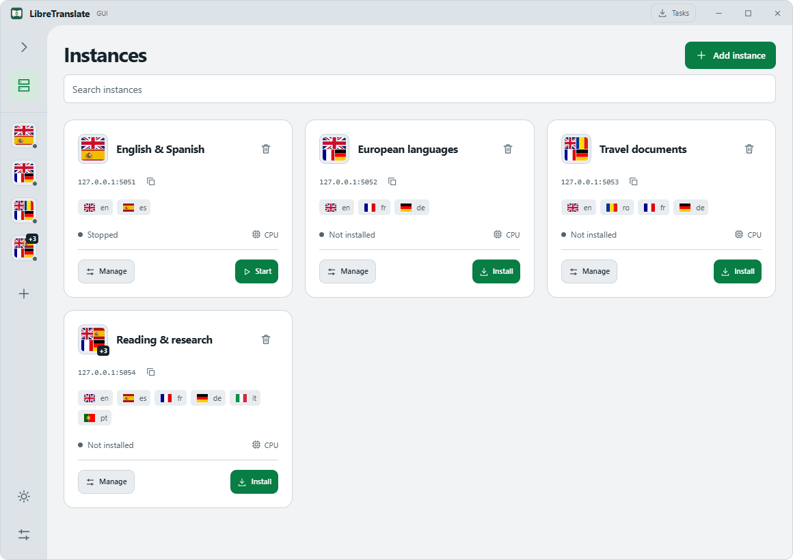

<p align="center">
  
</p>

<h1 align="center">LibreTranslate GUI</h1>

<p align="center">Run and manage LibreTranslate on your own computer.</p>

<p align="center">
  <a href="https://github.com/shadersmods/libretranslate-gui/releases"></a>
  <a href="https://github.com/shadersmods/libretranslate-gui/actions/workflows/build.yml"></a>
</p>

<p align="center">
  <a href="https://github.com/shadersmods/libretranslate-gui/releases">Download</a> ·
  <a href="#getting-started">Getting started</a> ·
  <a href="docs/usage.md">User guide</a> ·
  <a href="https://github.com/shadersmods/libretranslate-gui/issues">Issues</a>
</p>

LibreTranslate GUI is a desktop manager for local [LibreTranslate](https://github.com/LibreTranslate/LibreTranslate) servers. Create an instance, choose its languages, and translate text or files from the app. It installs a private Python runtime and downloads the models you need.

Translation runs on your computer and works offline once setup is complete. You don't need to install Docker or Python yourself.

<p align="center">
  
</p>

## What it does

- **Separate instances.** Give each server its own port, languages, runtime version, and settings. Start and stop them from the sidebar. Each instance gets an icon made from its selected language flags.
- **Text and file translation.** Translate as you type, detect the source language, or open a file and save the translated result. Drafts and file results stay available when you switch instances during a session.
- **Model management.** See installed and available translation pairs, check download sizes, and update models. Downloads are validated before existing models are replaced. One previous version is retained per pair.
- **CPU or CUDA.** Use the CPU by default, or select CUDA on supported NVIDIA hardware. Worker counts are configurable per instance.
- **Logs and metrics.** Follow setup and server logs. Enable Prometheus metrics to see request totals and response times in the Statistics tab.
- **Server settings.** Configure API keys, request limits, network access, and the LibreTranslate web interface. Servers listen on `127.0.0.1` by default.
- **20 interface languages.** Arabic uses a right-to-left layout. Light, dark, and system themes are available.

<p align="center">
  
</p>

## Getting started

Download the archive for your platform from [Releases](https://github.com/shadersmods/libretranslate-gui/releases), then extract it into a writable folder. On Windows and Linux, keep the executable and its `assets/` folder together. On macOS, open the included `.app` bundle and keep its contents intact.

1. Open **LibreTranslate GUI** and select **Add instance**.
2. Set a name and port, choose at least two languages, then select **Create instance**.
3. Select **Install runtime**. This installs the runtime and selected language models. Progress appears in Logs and the Tasks menu.
4. Select **Start server**. When the status is **Running**, open **Translator** to translate text or files.

Initial setup needs an internet connection and several GB of free space. Closing the app saves pending edits and stops its servers. A failed save restores the window so you can correct the problem and retry.

| Platform | Desktop requirements |
| --- | --- |
| Windows | Microsoft Edge WebView2 Runtime, normally included with modern Windows. |
| macOS | System WebKit. |
| Linux | GTK 3, WebKitGTK 4.1, and a graphical desktop session. |

The release workflow builds for all three platforms. Native macOS and Linux validation is still pending; the packages are unsigned.

## Your data

By default, `data/` and `libretranslate-desktop.json` live beside the executable. Each instance has its own runtime and models. **Options** lets you choose different folders for instance data, downloaded packages, and managed Python. Folder changes apply after restarting the app and do not move existing files.

Text and files are sent to the selected local server. The app checks GitHub and PyPI for updates and contacts package and model hosts for downloads. LAN access is optional.

See the [user guide](docs/usage.md) for storage overrides, runtime upgrades, CUDA setup, and model recovery. Server format restrictions, request limits, and timeouts still apply to file translation.

## Build from source

Install Rust **1.88 or newer** and your platform's [build dependencies](docs/usage.md#building), then run:

```sh
git clone https://github.com/shadersmods/libretranslate-gui.git
cd libretranslate-gui
cargo install dioxus-cli --version 0.7.10 --locked
dx serve --platform desktop
```

For a release build:

```sh
dx build --platform desktop --release --locked
```

The app uses official **Dioxus 0.7.10** from crates.io. The Dioxus CLI prepares the assets and component scripts; use `dx` to build the complete desktop app. Build output is under `target/dx/libretranslate-gui/release/`.

Run the checks before submitting a change:

```sh
cargo fmt --all -- --check
cargo clippy --locked --all-targets -- -D warnings
cargo test --locked
python tests/model_sync.py
```

CI runs the Python tests with Python 3.11. The default test suite does not download translation models or require a GPU. The [verification guide](docs/usage.md#verification) covers the optional runtime tests.

## Reporting problems

[Open an issue](https://github.com/shadersmods/libretranslate-gui/issues) with your operating system, app version, and steps to reproduce the problem. Include the relevant log output after removing API keys, tokens, and private text.

## Credits

Built by [Neo](https://github.com/shadersmods/libretranslate-gui) with [Dioxus](https://github.com/DioxusLabs/dioxus). Translation is provided by [LibreTranslate](https://github.com/LibreTranslate/LibreTranslate) and [Argos Translate](https://github.com/argosopentech/argos-translate).

Third-party source and license details are in [THIRD_PARTY_NOTICES.md](THIRD_PARTY_NOTICES.md).
